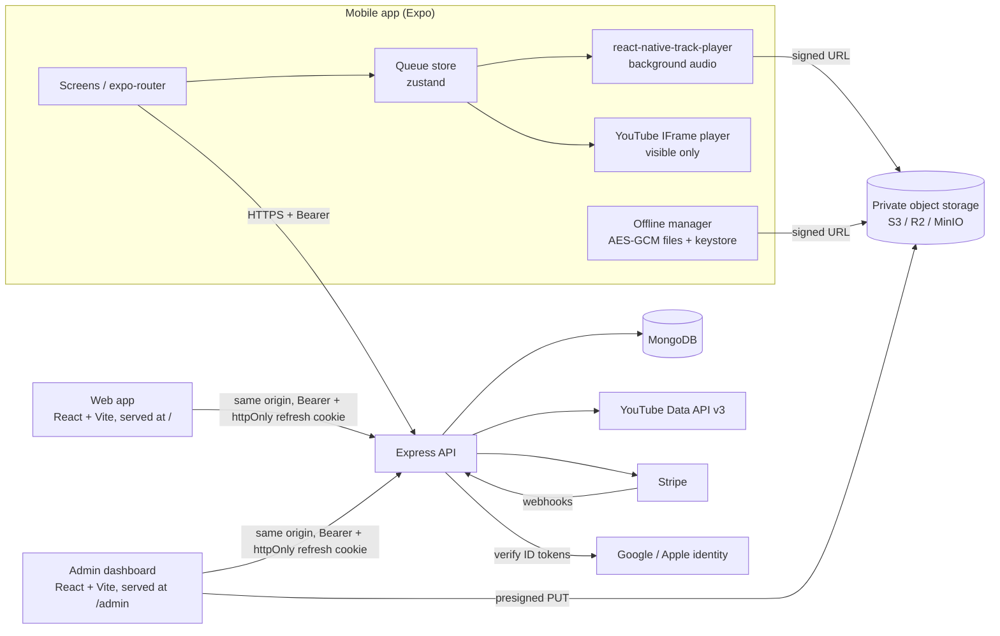
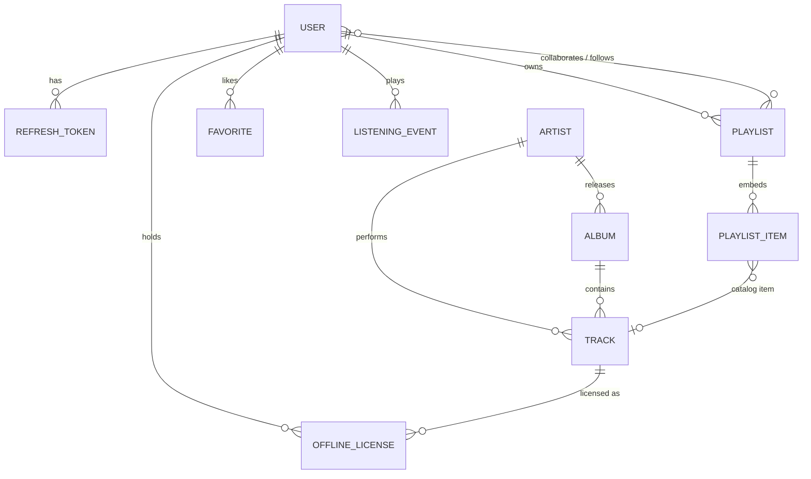
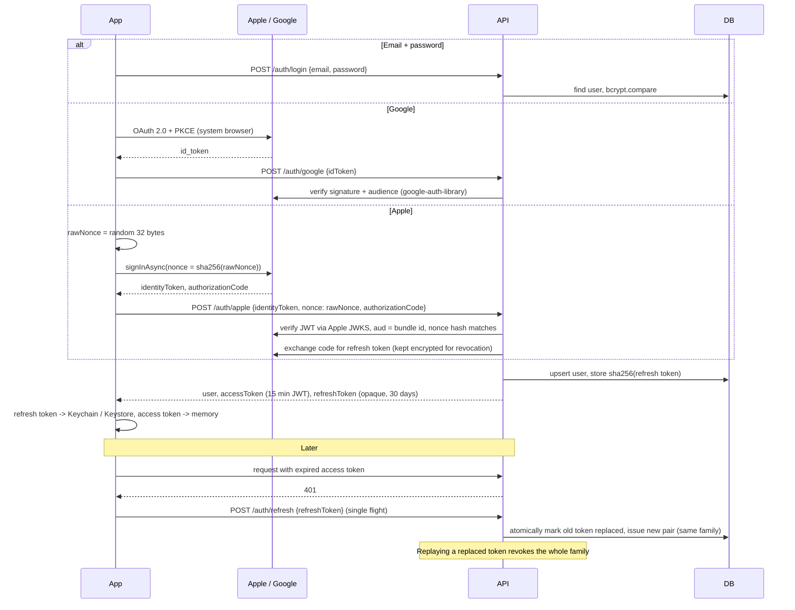

# Architecture

## Server (`server/`)

| Path | Responsibility |
|---|---|
| `src/config/env.js` | Validates every environment variable with zod at boot; refuses to start when misconfigured. |
| `src/app.js` | Helmet (strict CSP), CORS allow list, compression, rate limits, routing, JSON error handler. |
| `src/middleware/` | `requireAuth` / `optionalAuth` / `requireAdmin` / `requirePremium`, zod `validate`, rate limiters, error mapping. |
| `src/services/tokens.js` | Access JWTs, rotating refresh tokens with reuse detection, single-purpose tokens. |
| `src/services/socialAuth.js` | Google and Apple ID token verification; Apple REST token revocation. |
| `src/services/youtube.js` | YouTube search / video lookups with quota-saving cache. |
| `src/services/billing.js` | Stripe Checkout, Portal, webhook processing (idempotent). |
| `src/services/storage.js` | Presigned S3 upload and download URLs. |
| `src/services/offlineKeys.js` | Derives per-licence AES keys (HMAC-SHA256 of the licence id). |
| `src/routes/*` | HTTP endpoints, see [API.md](API.md). |

Every handler reads input only from `req.valid` (zod-parsed), so request bodies can't smuggle
MongoDB operators into queries.

## Database schema (MongoDB)

| Collection | Key fields | Indexes / lifecycle |
|---|---|---|
| `users` | `email`, `passwordHash` (bcrypt 12, never selected by default), `googleId`, `appleId`, `appleRefreshToken` (AES-GCM encrypted), `role`, `status`, `tokenVersion`, `subscription{plan,status,stripeCustomerId,stripeSubscriptionId,currentPeriodEnd,cancelAtPeriodEnd}`, `offlineDevices[]`, `preferences{theme,allowExplicit}`, `country` | unique partial on `email`, `googleId`, `appleId`; unique sparse `subscription.stripeCustomerId` |
| `refreshtokens` | `user`, `tokenHash` (SHA-256), `family`, `expiresAt`, `revokedAt`, `replacedAt` | unique `tokenHash`; TTL on `expiresAt` |
| `artists` | `name`, `bio`, `imageUrl`, `genres`, `verified` | text on `name` |
| `albums` | `title`, `artist`, `artworkUrl`, `releaseDate`, `label`, `upc` | `artist` |
| `tracks` | `title`, `artist`, `album`, `durationSec`, `explicit`, `isrc`, `artworkUrl`, `audioKey` (hidden), `freeTier`, `status` (draft / published / takedown), `playCount`, `rights{licenseType,licensor,licenseReference,attribution,territories[],streamAllowed,offlineAllowed,validFrom,validUntil}` | `status+createdAt`, `status+playCount`, `genres`, text on `title` |
| `playlists` | `owner`, `name`, `description`, `coverUrl`, `visibility`, `shareId`, `collaborators[]`, `followers[]`, `isEditorial`, `hidden`, `items[{kind, track \| videoId, addedBy, addedAt}]` (max 1000) | unique `shareId`; `owner`, `collaborators`, `isEditorial` |
| `favorites` | `user`, `kind`, `track` \| `videoId` | unique partial `(user, track)` and `(user, videoId)` |
| `listeningevents` | `user`, `kind`, `track` \| `videoId`, `playedAt`, `msPlayed`, `completed`, `offline`, `context`, `platform` | `user+playedAt`; TTL 365 days |
| `offlinelicenses` | `user`, `track`, `deviceId`, `expiresAt`, `revokedAt`, `revokeReason` | unique `(user, deviceId, track)` |
| `youtubecaches` | `key`, `value`, `expiresAt` | TTL (default 1 hour) |
| `webhookevents` | Stripe `eventId` | unique; TTL 60 days |
| `auditlogs` | `actor`, `action`, `targetType`, `targetId`, `meta`, `ip`, `at` | `at`, `target` |

YouTube items store **only the video id**. Titles, thumbnails and durations are fetched from
the API when a playlist / favorites / history page is read.

## Authentication flow

- **Account linking**: a Google / Apple identity is linked to an existing email account only
  when the provider says the email is verified. If the existing account never verified its
  email, its password is removed and its sessions are invalidated, so an attacker who
  pre-registered someone else's address can't keep access.
- **Sign out everywhere / suspension / role change** bump `tokenVersion`, invalidating every
  access token immediately, and delete all refresh tokens.
- **Admin dashboard** sends `X-Client: web`; the refresh token then goes in an httpOnly,
  `SameSite=Strict` cookie scoped to `/api/v1/auth` and the access token stays in memory.
- **Password reset tokens** are bound to a fingerprint of the current password hash, so they
  are single use and die once the password changes.

## Web app (`web/`)

Same features as the mobile app except offline downloads. The Express server serves its build
at `/` (and the admin build at `/admin`) with long-lived caching for hashed assets and an
`index.html` fallback for client-side routes.

- Sign-in: email / password, Google Identity Services and Sign in with Apple JS, all ending in
  the same API session. The refresh token is an httpOnly `SameSite=Strict` cookie; the access
  token stays in memory.
- Playback: catalog tracks play in an `<audio>` element from signed URLs (refreshed
  automatically if one expires mid-track), with Media Session support for media keys and OS
  controls. YouTube videos play in the official IFrame player, docked on screen whenever one is
  current. Queue, shuffle, repeat, sleep timer and volume live in a persisted zustand store.

## Playback design (mobile)

- `player/store.ts` (zustand, persisted) owns the queue, shuffle (keeps the original order to
  restore), repeat mode and sleep timer.
- `player/engine.ts` loads the current item:
  - **catalog track**: decrypted offline file if downloaded, otherwise a 10 minute signed URL
    from `GET /catalog/tracks/:id/stream`; played by `react-native-track-player`, which handles
    background audio, audio focus / interruptions and lock-screen controls.
  - **YouTube video**: handed to `YouTubeView` (the official IFrame player via
    `react-native-youtube-iframe`) on the Now Playing screen. Leaving that screen or
    backgrounding the app pauses it. The queue stops at a YouTube item while in the background.
- `player/service.ts` is the headless playback service: remote controls, advancing the queue
  when a catalog track ends, sleep timer checks.
- `player/history.ts` reports plays ≥30 s (or completed), buffering them offline.

## Offline downloads

1. The app registers a device id (random UUID in SecureStore); the server limits devices per
   account (`MAX_OFFLINE_DEVICES`).
2. `POST /downloads/licenses` checks Premium, rights (`offlineAllowed`, territory, validity
   window) and returns a licence, a 15 minute signed download URL and a 256-bit content key.
   Licence expiry is the earliest of 30 days, the content licence end and the paid period end.
3. The app downloads over HTTPS to the cache directory, encrypts it in 512 KB AES-256-GCM
   chunks (licence id, chunk index and last-chunk flag bound as AAD) into app-private storage,
   deletes the plaintext and keeps the key in the Keychain / Keystore (`THIS_DEVICE_ONLY`).
4. To play, the file is decrypted into a single temporary cache file that is deleted on the
   next track and on every launch.
5. `POST /downloads/licenses/sync` (on launch, on reconnect, on foreground) renews licences and
   returns revoked ones (takedown, rights change, subscription ended, device removed); the app
   deletes those files and keys. Expired licences are purged even while offline.

Client-side encryption protects files at rest and ties them to the app and account. If a
licensor contract requires studio-grade DRM, serve the catalog through a DRM packager
(Widevine / FairPlay) instead; the licence and rights model here stays the same.
